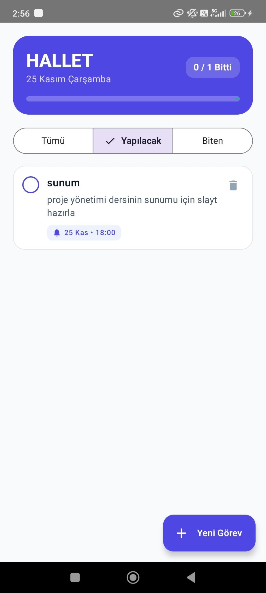
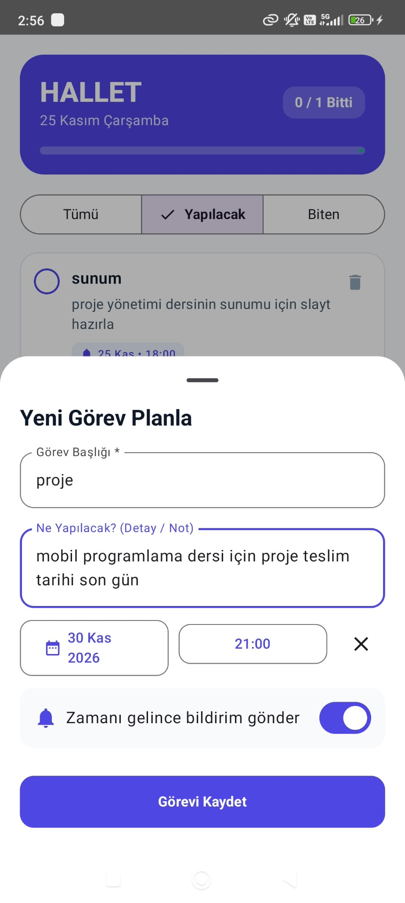

<div align="center">

# ✅ HALLET

**Kişisel görevlerini, günlük planlarını ve zamanlı hatırlatıcılarını tek yerden yönetmeni sağlayan modern, çevrimdışı Android uygulaması.**


-3DDC84?style=for-the-badge&logo=android&logoColor=white)

</div>

---

## 📱 Uygulama Hakkında

**HALLET**, internet bağlantısı veya üyelik gerektirmeden çalışan, tamamen cihaz içi yerel veritabanı kullanan kişisel bir görev takip ve hatırlatıcı uygulamasıdır. Günlük ilerleme durumunu anlık takip etmeni, görevlere detaylı açıklamalar eklemeni ve zamanı geldiğinde bildirim almanı sağlar.

### ✨ Öne Çıkan Özellikler

* **Tam Görev Yönetimi (CRUD):** Yeni görev ekleme, kart üzerine dokunarak mevcut görevi düzenleme, tamamlama ve silme.
* **Detaylı Görev Planlama:** Kısa başlığın yanına yapılacak adımları içeren detaylı açıklama notu ekleme.
* **Akıllı Tarih & Saat Seçici:** Material 3 takvim ve saat seçici ile görev planlama; süresi geçen tamamlanmamış görevler için otomatik kırmızı gecikme uyarısı.
* **Arka Plan Bildirim Sistemi:** Uygulama kapalı olsa dahi planlanan dakikada bildirim gönderen `AlarmManager` ve `BroadcastReceiver` altyapısı *(görev tamamlandığında veya silindiğinde alarm otomatik iptal edilir)*.
* **Anlık Filtreleme:** **Tümü**, **Yapılacak** ve **Biten** sekmeleri arasında akıcı geçiş.
* **Günlük İlerleme Takibi:** Ana ekran üst kartında tamamlanan/toplam görev oranı ve dinamik ilerleme çubuğu.
* **%100 Çevrimdışı & Kalıcı Depolama:** Veriler Room (SQLite) veritabanında güvenle saklanır.

---

## 🛠️ Teknoloji Yığını ve Mimari

Uygulama, modern Android geliştirme standartlarına uygun olarak **MVVM (Model-View-ViewModel)** mimarisi ve reaktif veri akışı prensipleriyle geliştirilmiştir:

| Katman | Kullanılan Teknoloji |
| :--- | :--- |
| **Dil** | Kotlin 2.0 |
| **Kullanıcı Arayüzü** | Jetpack Compose & Material Design 3 |
| **Mimari & Durum Yönetimi** | MVVM, `AndroidViewModel`, `StateFlow`, Kotlin Coroutines |
| **Yerel Veritabanı** | Room Persistence Library (`2.7.1`) & KSP |
| **Bildirim & Zamanlama** | `AlarmManager`, `BroadcastReceiver`, `NotificationCompat` |

---

## 📂 Proje Yapısı

```text
com.example.hallet
├── MainActivity.kt          # Material 3 tema, ana ekran, ilerleme kartı ve görev formu (BottomSheet)
├── GorevViewModel.kt        # UI durumu, filtreleme (Flow.combine) ve iş mantığı
├── AppDatabase.kt           # Singleton Room veritabanı yapılandırması
├── GorevDao.kt              # SQLite veri erişim nesnesi (Ekle, Güncelle, Sil, Listele)
├── GorevEntity.kt           # Görevler tablosu veri modeli
├── BildirimPlanlayici.kt    # AlarmManager üzerinden bildirim kurma ve iptal işlemleri
└── BildirimReceiver.kt      # Zamanı gelen hatırlatıcıları bildirim çubuğuna ileten alıcı
```

---

## 🚀 Kurulum ve Çalıştırma

1. Depoyu bilgisayarına klonla:
   ```bash
   git clone [https://github.com/abdullahokyay/HALLET.git](https://github.com/abdullahokyay/HALLET.git)
   ```
2. Projeyi **Android Studio** ile aç ve Gradle senkronizasyonunun tamamlanmasını bekle.
3. En az **Android 7.0 (API 24)** sürümüne sahip bir emülatör veya fiziksel Android cihaz bağla.
4. **Run (`Shift + F10`)** tuşuna basarak uygulamayı başlat ve açılışta bildirim iznini onayla.

---

## 📸 Ekran Görüntüleri

<p align="center">
  
  &nbsp;&nbsp;&nbsp;&nbsp;
  
</p>